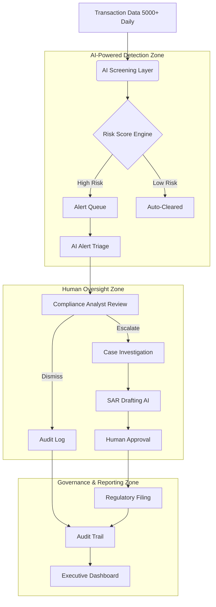

# 🏦 AI Compliance Command Center
### Banking & Financial Crime Compliance Intelligence

> **WICxAI Innovator Program — Cohort 2026 | Capstone Project**
> Team Jampseek · Sprint Timeline: May 2026 – July 2026

[](https://miro.com)
[](https://azure.microsoft.com/en-us/products/ai-services/openai-service)
[](https://aistudio.google.com)
[](https://figma.com)
[](https://vercel.com)
[](https://supabase.com)

---

## 📖 Project Overview

A global bank processing 5,000+ daily transactions is facing a growing financial crime compliance crisis. Compliance analysts are overwhelmed by alert reviews, manual investigations, and regulatory reporting — while fraud patterns evolve faster than manual systems can respond.

**Our mission** is to reimagine the compliance operating model by designing a practical, scalable, human-centered AI strategy that:

- Detects fraud and prioritises alerts intelligently
- Accelerates case investigation through AI-assisted workflows
- Automates documentation while keeping humans in control
- Ensures governance, explainability, and regulatory readiness
- Delivers measurable business value and risk reduction

---

## 🏗️ AI Compliance System Architecture



---

## 👥 Roles & Responsibilities

| Member | Role | Core Responsibility |
|--------|------|-------------------|
| **Kelly Howell** | Project Lead & AML Domain Expert | Leads project structure, sprint planning, and task coordination. Brings real-world AML compliance knowledge from industry experience. Owns discovery, stakeholder interviews, and AI Innovation Map. |
| **Sadia Mehmood** | Tech Lead — Architecture, Integration & Governance | Leads system architecture, tech stack design, integration requirements, and governance framework. Drives executive presentation strategy and responsible AI principles. |

---

## 📦 Deliverables

| # | Deliverable | Description | Status |
|---|-------------|-------------|--------|
| 1 | AI Innovation Map | Future-state AI transformation strategy | Done |
| 2 | End-to-End Workflow Architecture | AI-enabled compliance workflow ecosystem | Done |
| 3 | Human Governance Model | Human-centered governance framework | Done |
| 4 | AI Agent Demo + Executive Presentation | Prototype demo and executive pitch | Done |
| 5 | AI Workflow Prompt Library | Prompt library supporting AI workflow design | Done |
| 6 | Final Presentation | Capstone pitch and submission | Done |

---

## 📂 Repository Structure

```
Compliance-Dashboard/
├── docs/
│   ├── ai-innovation-map/        # Deliverable 1 — Strategy & opportunity mapping
│   ├── workflow-architecture/    # Deliverable 2 — End-to-end workflow design
│   ├── governance-model/         # Deliverable 3 — Human governance framework
│   └── prompt-library/           # Deliverable 5 — AI workflow prompt library
├── diagrams/                     # Miro exports, architecture & workflow diagrams
├── presentations/                # Executive deck drafts and final slides
├── demos/                        # Demo scripts, prototype files, mock dashboards
└── README.md
```

---

## 🛠️ Tools & Technologies

| Category | Tool |
|----------|------|
| Project Management | Notion |
| Visual Collaboration | Miro |
| Version Control | GitHub |
| AI/LLM | Azure OpenAI / Google AI Studio |
| Prototyping | Figma |
| Hosting (Demo) | Vercel / Render |
| Database (Demo) | Supabase |

---

## 🗓️ Project Timeline

| Sprint | Timeframe | Focus |
|--------|-----------|-------|
| Sprint A | May 24 – June 7 | Discovery, AI Innovation Map, Workflow Architecture |
| Sprint B | June 7 – June 21 | Governance Model, Demo Development |
| Sprint C | June 21 – June 28 | Prompt Library, Final Submission |
| Final | July 5 – July 12 | Runthrough & Presentation |

---

## ✅ Action Items — Sprint A (May 24 – June 7)

- [ ] **@KellyHowell** — Complete current-state assessment and stakeholder interview notes
- [ ] **@KellyHowell** — Finalise AI Use Case Register
- [ ] **@KellyHowell** — Complete scoring matrix and AI Innovation Map v1.0
- [ ] **@SadiaMehmood** — Set up GitHub repository structure and documentation
- [ ] **@SadiaMehmood** — Complete integration requirements register
- [ ] **@SadiaMehmood** — Design technology layer and tech stack diagram
- [ ] **@SadiaMehmood** — Support workflow architecture research and process mapping
- [ ] **All** — Attend Progress Meeting 1 on June 6 with initial concepts and questions

---

## 🔑 Key Question

> *If this AI compliance system were deployed tomorrow at a global bank — would executives trust it, would regulators approve it, and would investigators actually use it?*

---

## 📄 Documentation & Resources

- [Notion Project Board](https://www.notion.so/Jampseek-Engineering-Dashboard)
- [Miro Workspace](#) *(link to be added)*
- [Executive Presentation](#) *(link to be added)*
- [Capstone Brief](docs/ai-innovation-map/Capstone_Project_Brief.pdf)

---

## 🤝 Contributing

Please read [CONTRIBUTING.md](CONTRIBUTING.md) before making any changes.
All team members should work on feature branches and submit pull requests for review before merging into `main`.

---

*WICxAI Innovator Program Cohort 2026 · Women in Cloud · Capstone Project*
